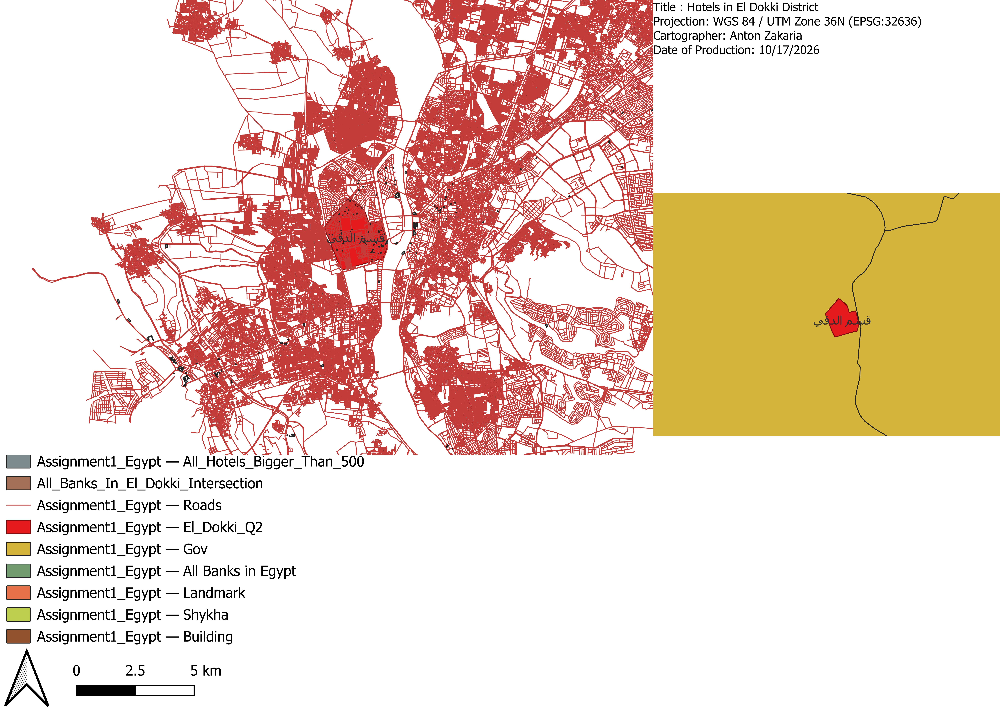

INTRO TO MAPPING AND GIS

# Lab Exercise #1

---

STUDENT NAME

Anton Zakaria Ezzat

STUDENT ID

20231030

COURSE

Intro to Mapping and GIS

ASSIGNMENT

Lab Exercise #1

---

## Download

Everything is inside **`Egypt.gdb`** — all 11 layers, all in **EPSG:32636 (WGS 84 / UTM zone 36N)**.

Open it with **Layer → Add Layer → Add Vector Layer → Browse → select the `Egypt.gdb` folder → Open**.

The same layers are also available as a GeoPackage, **[`Assignment1_Egypt.gpkg`](https://github.com/Tony-Devv/GIS_Assignment_1/releases)** — 137 MB, too large for git, so it is attached to the [Releases page](https://github.com/Tony-Devv/GIS_Assignment_1/releases).

---

## Deliverables

### Q1 — Geodatabase with a unified projection system (WGS1984)

**[`Egypt.gdb`](Egypt.gdb)**

| Layer | Features | Layer | Features |
|---|---|---|---|
| Gov | 27 | Roads | 192,352 |
| Building | 149,756 | Shykha | 5,814 |
| Landmark | 98,462 | | |

### Q2 — Area and location of El Dokki

**Area:** 5,091,867.89 m² (Cartesian) · 5,092,183.65 m² (Ellipsoidal) — **5.09 km²**
**DMS:** 31° 12′ 25.92″ E · 30° 02′ 36.96″ N
**Meters (EPSG:32636):** X = 327,330 m E · Y = 3,324,840 m N

### Q3 — Length of El Tahrir street

**7,623.535 m = 7.624 km**
Measured with the Measure Line tool. All 309 line features carrying this street name total 16.720 km.

### Q4 — Area of Elsaid club

**232,133.219 m² = 0.232 km²**
Measured with the Measure Area tool.

### Q5 — Banks in the Dokki area, with an area column

Layer **`All_Banks_In_El_Dokki`** — 48 bank polygons, each carrying an `Area` column.
Extracted from `Landmark` by matching `A_NAME1` against the Arabic word for bank, then `Extract by location` against the El Dokki markaz polygon.

### Q7 — Hotels from the Landmark layer with area > 500 m²

Layer **`All_Banks_Bigger_Than_500`** — 171 hotel polygons.
Area computed with `$area` in EPSG:32636, then filtered to `A_NAME1` matching the Arabic word for hotel and area &gt; 500 m².

### Q8 — Map export, JPEG at 700 dpi

**[`Dokki_Map_Layout.jpeg`](Dokki_Map_Layout.jpeg)** — 8,185 × 5,787 px at **700 dpi** (A4 landscape, 297 × 210 mm).

Map elements included: title, verbal (nominal) scale, north arrow, legend, date of production, inset map, locator map, neatline, projection, cartographer.

### Q9 — Schools converted to points, exported as PDF

Layers **`Do_Schools`** (208 polygons) and **`Do_school_point`** (208 points).

**[`Question_9.pdf`](Question_9.pdf)** — A3 landscape. Nominal (verbal) scale: *1 cm on this map represents 500 m on the ground*, with representative fraction 1:50,000 and a graphic scale bar.

---

## Notes on the source data

**Encoding.** The supplied `egyptfinal.mdb` stores its Arabic text in Windows-1256, but the OGR PGeo driver passes those bytes through unconverted, so the attribute tables displayed `�` for every Arabic value. The encoding was corrected to UTF-8 before any layer was written, which is why all Arabic field names and values read correctly in the delivered data.

**Two items named in the brief are absent from the supplied data:**

- **NILE** — no Nile layer exists in `egyptfinal.mdb`. The feature classes present are Roads, Building, Landmark and the census/administrative layers.
- **"El Said club" (Q4)** — the Landmark layer contains 1,395 club polygons (names containing `نادي` / `نادى`), none of which carries `سعيد` in its name. Q4 therefore reports the area of a different club feature.
